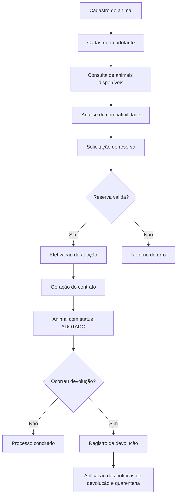

# Sistema de Adoção de Animais

Projeto acadêmico individual desenvolvido em Python para a disciplina de Programação Orientada a Objetos (POO). O sistema tem como finalidade auxiliar no gerenciamento de animais disponíveis para adoção, adotantes cadastrados e processos relacionados à reserva, adoção e devolução de animais.

A aplicação utiliza uma interface de terminal (CLI), persistência de dados em arquivos JSON e uma estrutura organizada em classes, aplicando conceitos de orientação a objetos e padrões de projeto estudados durante a disciplina.

## Sumário

- [1. Sobre o Projeto](#1-sobre-o-projeto)
- [2. Objetivos](#2-objetivos)
- [3. Funcionalidades do Sistema](#3-funcionalidades-do-sistema)
- [4. Tecnologias e Requisitos](#4-tecnologias-e-requisitos)
- [5. Estrutura de Diretórios](#5-estrutura-de-diretórios)
- [6. Escopo dos Diretórios e Arquivos](#6-escopo-dos-diretórios-e-arquivos)
- [7. Instalação e Execução](#7-instalação-e-execução)
  - [7.1. Windows](#71-windows)
  - [7.2. Linux](#72-linux)
  - [7.3. macOS](#73-macos)
- [8. Interface e Utilização](#8-interface-e-utilização)
- [9. Cadastro e Gerenciamento de Dados](#9-cadastro-e-gerenciamento-de-dados)
- [10. Processo de Adoção](#10-processo-de-adoção)
- [11. Sistema de Compatibilidade](#11-sistema-de-compatibilidade)
- [12. Políticas e Regras de Negócio](#12-políticas-e-regras-de-negócio)
- [13. Persistência de Dados](#13-persistência-de-dados)
- [14. Configurações do Sistema](#14-configurações-do-sistema)
- [15. Tratamento de Exceções](#15-tratamento-de-exceções)
- [16. Testes Automatizados](#16-testes-automatizados)
- [17. Conceitos de Programação Orientada a Objetos](#17-conceitos-de-programação-orientada-a-objetos)
- [18. Padrões de Projeto](#18-padrões-de-projeto)
- [19. Documentação UML](#19-documentação-uml)
- [20. Limitações e Considerações](#20-limitações-e-considerações)
- [21. Autoria](#21-autoria)

---

## 1. Sobre o Projeto

O Sistema de Adoção de Animais é uma aplicação desenvolvida para representar, de maneira simplificada, o funcionamento de um sistema de gerenciamento de adoção de animais.

A aplicação permite o cadastro de cães, gatos e pessoas interessadas na adoção. A partir desses registros, é possível realizar consultas, verificar compatibilidade entre adotantes e animais, efetuar reservas, concluir adoções e registrar devoluções.

O projeto também contempla regras de negócio relacionadas às condições de moradia, idade mínima do adotante, duração de reservas, compatibilidade e taxas de adoção.

A aplicação foi desenvolvida com foco na organização do código, separação de responsabilidades e aplicação prática dos conceitos de Programação Orientada a Objetos.

## 2. Objetivos

O principal objetivo do projeto é desenvolver uma aplicação funcional que permita aplicar os conceitos de Programação Orientada a Objetos em um contexto prático.

Entre os objetivos específicos, estão:

- Representar animais e adotantes por meio de classes.
- Aplicar herança entre classes relacionadas.
- Organizar os comportamentos e atributos das entidades.
- Implementar relacionamentos entre os objetos do sistema.
- Desenvolver regras de negócio para os processos de adoção.
- Implementar persistência de dados utilizando arquivos JSON.
- Aplicar padrões de projeto para organizar comportamentos específicos.
- Desenvolver testes automatizados para verificar o funcionamento das classes.
- Organizar o projeto em módulos e diretórios com responsabilidades definidas.

## 3. Funcionalidades do Sistema

### 3.1. Gerenciamento de Animais

O sistema permite cadastrar e consultar animais disponíveis para adoção.

As funcionalidades incluem:

- Cadastro de cães e gatos.
- Identificação dos animais por ID único.
- Registro de nome, raça, sexo, idade, porte e temperamento.
- Registro da data de entrada no sistema.
- Cadastro de características específicas de cada espécie.
- Listagem de animais cadastrados.
- Filtragem de animais por status.
- Consulta de animais por identificador.
- Controle do status dos animais durante os processos de adoção e devolução.

### 3.2. Gerenciamento de Adotantes

O sistema permite cadastrar pessoas interessadas em adotar animais.

As informações registradas incluem:

- CPF;
- nome completo;
- idade;
- telefone;
- e-mail;
- tipo de moradia;
- área útil da residência;
- experiência anterior com animais;
- presença de crianças na residência;
- presença de outros animais;
- quantidade de animais que o adotante já possuiu.

Também são disponibilizadas funcionalidades para listar e consultar adotantes cadastrados.

### 3.3. Reserva de Animais

O sistema permite que um adotante cadastrado solicite a reserva de um animal.

O processo envolve:

- identificação do animal;
- identificação do adotante;
- validação das condições de reserva;
- aplicação da política de reserva;
- atualização do status do animal.

### 3.4. Efetivação da Adoção

A adoção representa a conclusão do processo de transferência do animal para o adotante.

As funcionalidades incluem:

- verificação da reserva;
- validação das condições de adoção;
- aplicação da política de adoção;
- cálculo da taxa correspondente;
- atualização do status do animal;
- geração de contrato de adoção.

### 3.5. Devolução de Animais

O sistema permite registrar a devolução de um animal que já foi adotado.

São informados:

- identificador do animal;
- motivo da devolução;
- condição física do animal.

A devolução é processada de acordo com as políticas implementadas, podendo resultar na atualização do status do animal e na aplicação das regras de quarentena.

### 3.6. Análise de Compatibilidade

O sistema possui um mecanismo de análise de compatibilidade entre adotantes e animais disponíveis.

A pontuação é calculada considerando critérios relacionados ao perfil do adotante e às características do animal.

Os resultados são apresentados em ordem decrescente de pontuação, permitindo identificar os animais com maior compatibilidade.

### 3.7. Inserção de Dados de Exemplo

A aplicação disponibiliza uma opção para inserir registros de exemplo.

Essa funcionalidade permite cadastrar animais e adotantes fictícios para facilitar a utilização e os testes do sistema.

### 3.8. Persistência de Dados

Os dados são armazenados em arquivos JSON, permitindo que os registros permaneçam disponíveis após o encerramento da aplicação.

A persistência é realizada por meio da classe `Repositorio`.

---

## 4. Tecnologias e Requisitos

### Tecnologias utilizadas

| Tecnologia | Finalidade |
|---|---|
| Python | Linguagem de programação utilizada no desenvolvimento. |
| JSON | Formato de armazenamento dos dados. |
| pytest | Framework utilizado para testes automatizados. |
| Git | Controle de versão do projeto. |
| Markdown | Formato utilizado na documentação. |

### Requisitos de execução

- Python 3.12 ou superior recomendado.
- Terminal ou prompt de comando.
- Ambiente virtual Python recomendado.
- Dependência `pytest` para execução dos testes.

O sistema utiliza módulos da biblioteca padrão do Python para seu funcionamento principal, não exigindo a instalação de um banco de dados externo.

---

## 5. Estrutura de Diretórios

A organização do projeto está distribuída da seguinte forma:

```text
Sistema-de-Adocao-de-Animais-POO/
│
├── main.py
├── relatorios.py
├── settings.json
├── requirements.txt
├── pytest.ini
├── README.md
├── .gitignore
│
├── classes/
│   ├── __init__.py
│   ├── sistema_adocao.py
│   ├── excecoes.py
│   ├── status_animal.py
│   │
│   ├── animais/
│   │   ├── __init__.py
│   │   ├── animal.py
│   │   ├── cachorro.py
│   │   └── gato.py
│   │
│   ├── pessoas/
│   │   ├── __init__.py
│   │   ├── pessoa.py
│   │   └── adotante.py
│   │
│   ├── mixins/
│   │   ├── __init__.py
│   │   ├── vacinavel_mixin.py
│   │   └── adestravel_mixin.py
│   │
│   ├── politicas/
│   │   ├── __init__.py
│   │   ├── politica.py
│   │   ├── politica_reserva.py
│   │   ├── politica_adocao.py
│   │   ├── politica_devolucao.py
│   │   └── politica_quarentena.py
│   │
│   ├── processos/
│   │   ├── __init__.py
│   │   ├── reserva.py
│   │   ├── adocao.py
│   │   └── devolucao.py
│   │
│   ├── taxas/
│   │   ├── __init__.py
│   │   ├── base_fee_strategy.py
│   │   ├── puppy_fee.py
│   │   ├── senior_fee.py
│   │   └── special_care_fee.py
│   │
│   └── infra/
│       ├── __init__.py
│       ├── repositorio.py
│       └── fila_espera.py
│
├── data/
│   ├── animais.json
│   └── adotantes.json
│
├── docs/
│   ├── UML.md
│   └── UML_visual.md
│
└── teste_classes/
    └── test_classes.py
```

---

## 6. Escopo dos Diretórios e Arquivos

### Diretório `classes/`

Contém as classes responsáveis pela implementação das entidades, regras de negócio e processos do sistema.

| Arquivo/Diretório | Responsabilidade |
|---|---|
| `sistema_adocao.py` | Classe controladora responsável por coordenar as funcionalidades do sistema. |
| `excecoes.py` | Definição das exceções específicas utilizadas pela aplicação. |
| `status_animal.py` | Enumeração dos status possíveis dos animais. |
| `animais/` | Classes relacionadas à representação dos animais. |
| `pessoas/` | Classes relacionadas à representação das pessoas e adotantes. |
| `mixins/` | Comportamentos adicionais compartilhados entre classes. |
| `politicas/` | Implementação das regras de negócio relacionadas aos processos. |
| `processos/` | Classes que representam os processos de reserva, adoção e devolução. |
| `taxas/` | Estratégias utilizadas para o cálculo das taxas de adoção. |
| `infra/` | Componentes de infraestrutura, persistência e fila de espera. |

### Diretório `classes/animais/`

Responsável pela representação dos animais.

- `animal.py`: classe base abstrata `Animal`.
- `cachorro.py`: classe `Cachorro`, especializada na representação de cães.
- `gato.py`: classe `Gato`, especializada na representação de gatos.

As classes compartilham características comuns definidas na classe base e possuem atributos específicos de cada espécie.

### Diretório `classes/pessoas/`

Responsável pela representação das pessoas envolvidas no processo de adoção.

- `pessoa.py`: classe base `Pessoa`.
- `adotante.py`: classe `Adotante`, que representa pessoas interessadas em adotar animais.

### Diretório `classes/mixins/`

Contém classes que disponibilizam comportamentos adicionais.

- `vacinavel_mixin.py`: comportamentos relacionados à vacinação.
- `adestrável_mixin.py`: comportamentos relacionados ao adestramento.

### Diretório `classes/politicas/`

Responsável pela implementação das regras de negócio.

- `politica.py`: classe base das políticas.
- `politica_reserva.py`: regras para reservas.
- `politica_adocao.py`: regras para efetivação da adoção.
- `politica_devolucao.py`: regras para devoluções.
- `politica_quarentena.py`: regras relacionadas à quarentena.

### Diretório `classes/processos/`

Contém as classes responsáveis por representar os processos do sistema.

- `reserva.py`: representação de uma reserva.
- `adocao.py`: representação de uma adoção e geração de contrato.
- `devolucao.py`: representação de uma devolução.

### Diretório `classes/taxas/`

Responsável pela implementação das estratégias de cálculo das taxas.

- `base_fee_strategy.py`: classe base das estratégias.
- `puppy_fee.py`: estratégia relacionada a animais filhotes.
- `senior_fee.py`: estratégia relacionada a animais idosos.
- `special_care_fee.py`: estratégia relacionada a cuidados especiais.

### Diretório `classes/infra/`

Contém componentes utilizados para a infraestrutura da aplicação.

- `repositorio.py`: responsável pela persistência de dados em arquivos JSON.
- `fila_espera.py`: implementação da estrutura de fila de espera.

### Diretório `data/`

Armazena os arquivos utilizados para persistência dos registros.

| Arquivo | Conteúdo |
|---|---|
| `animais.json` | Registros dos animais cadastrados. |
| `adotantes.json` | Registros dos adotantes cadastrados. |

### Diretório `docs/`

Contém a documentação complementar do projeto.

- `UML.md`: documentação dos diagramas UML.
- `UML_visual.md`: representação visual da modelagem.

### Diretório `teste_classes/`

Contém os testes automatizados utilizados para verificar o comportamento das classes.

- `test_classes.py`: arquivo principal de testes.

### Arquivos da raiz

| Arquivo | Responsabilidade |
|---|---|
| `main.py` | Ponto de entrada da aplicação e implementação da interface de terminal. |
| `relatorios.py` | Funções de geração de relatórios textuais. |
| `settings.json` | Configurações das regras do sistema. |
| `requirements.txt` | Lista de dependências Python. |
| `pytest.ini` | Configuração do pytest. |
| `README.md` | Documentação principal do projeto. |
| `.gitignore` | Arquivos e diretórios ignorados pelo Git. |

---

## 7. Instalação e Execução

O sistema pode ser executado em Windows, Linux e macOS, desde que o Python esteja instalado e configurado corretamente.

### 7.1. Windows

Abra o PowerShell ou o terminal do VS Code na pasta do projeto.

**1. Verificar a instalação do Python**

```powershell
python --version
```

**2. Criar um ambiente virtual**

```powershell
python -m venv .venv
```

**3. Ativar o ambiente virtual**

```powershell
.\.venv\Scripts\Activate.ps1
```

Caso esteja utilizando o Prompt de Comando (CMD):

```cmd
.venv\Scripts\activate.bat
```

**4. Instalar as dependências**

```powershell
python -m pip install -r requirements.txt
```

**5. Executar o sistema**

```powershell
python main.py
```

### 7.2. Linux

Abra o terminal na pasta do projeto.

**1. Verificar a instalação do Python**

```bash
python3 --version
```

Caso o Python ou os módulos necessários ainda não estejam instalados, em distribuições baseadas em Debian ou Ubuntu:

```bash
sudo apt update
sudo apt install python3 python3-venv python3-pip
```

**2. Criar um ambiente virtual**

```bash
python3 -m venv .venv
```

**3. Ativar o ambiente virtual**

```bash
source .venv/bin/activate
```

**4. Instalar as dependências**

```bash
python -m pip install -r requirements.txt
```

**5. Executar o sistema**

```bash
python main.py
```

### 7.3. macOS

Abra o Terminal na pasta do projeto.

**1. Verificar a instalação do Python**

```bash
python3 --version
```

**2. Criar um ambiente virtual**

```bash
python3 -m venv .venv
```

**3. Ativar o ambiente virtual**

```bash
source .venv/bin/activate
```

**4. Instalar as dependências**

```bash
python -m pip install -r requirements.txt
```

**5. Executar o sistema**

```bash
python main.py
```

### Encerramento do ambiente virtual

Após utilizar o sistema, o ambiente virtual pode ser desativado em qualquer sistema operacional com o comando:

```bash
deactivate
```

---

## 8. Interface e Utilização

A aplicação possui uma interface de terminal baseada em um menu numérico.

Ao executar o arquivo `main.py`, o sistema apresenta as opções disponíveis para utilização.

### Menu principal

| Opção | Funcionalidade |
|---:|---|
| `1` | Cadastrar novo animal |
| `2` | Listar animais |
| `3` | Cadastrar novo adotante |
| `4` | Listar adotantes |
| `5` | Reservar animal |
| `6` | Efetivar adoção e gerar contrato |
| `7` | Devolver animal |
| `8` | Verificar compatibilidade (Match) |
| `99` | Inserir dados de exemplo (Seed) |
| `0` | Sair do sistema |

### Funcionamento das opções

**Opção 1 — Cadastrar novo animal**

Permite registrar um novo animal no sistema.

O usuário deve informar a espécie, identificador, raça, nome, sexo, idade em meses, porte, temperamento e data de entrada.

Também são solicitadas informações específicas de acordo com a espécie:

- Cachorro: necessidade de passeio.
- Gato: nível de independência.

**Opção 2 — Listar animais**

Exibe os animais cadastrados no sistema.

É possível informar um status para filtrar os resultados. Caso o campo seja deixado vazio, todos os animais cadastrados serão apresentados.

**Opção 3 — Cadastrar novo adotante**

Permite registrar uma pessoa interessada em adotar um animal.

O cadastro solicita informações pessoais e dados relacionados às condições de moradia e experiência com animais.

**Opção 4 — Listar adotantes**

Exibe os adotantes cadastrados, incluindo CPF, nome, idade e tipo de moradia.

**Opção 5 — Reservar animal**

Permite solicitar a reserva de um animal.

Para realizar a operação, são necessários o ID do animal e o CPF do adotante.

**Opção 6 — Efetivar adoção**

Conclui o processo de adoção de um animal reservado.

Após a efetivação, o sistema apresenta o contrato de adoção gerado.

**Opção 7 — Devolver animal**

Permite registrar a devolução de um animal adotado, informando o motivo e sua condição física.

**Opção 8 — Verificar compatibilidade**

Calcula a pontuação de compatibilidade entre um adotante e os animais disponíveis.

Os resultados são apresentados em ordem decrescente de pontuação.

**Opção 99 — Inserir dados de exemplo**

Realiza o cadastro de registros fictícios para facilitar a utilização do sistema.

**Opção 0 — Sair do sistema**

Encerra a execução da aplicação.

---

## 9. Cadastro e Gerenciamento de Dados

### 9.1. Cadastro de Animais

Os animais são cadastrados de acordo com sua espécie.

Os atributos comuns incluem:

| Atributo | Descrição |
|---|---|
| `id_animal` | Identificador único do animal. |
| `raca` | Raça do animal. |
| `nome` | Nome do animal. |
| `sexo` | Sexo do animal. |
| `idade_meses` | Idade expressa em meses. |
| `porte` | Porte do animal. |
| `temperamento` | Características comportamentais. |
| `data_entrada` | Data de entrada no sistema. |
| `status` | Estado atual do animal. |

Os atributos específicos incluem:

- `necessidade_passeio`: característica relacionada aos cães.
- `independencia`: característica relacionada aos gatos.

### 9.2. Cadastro de Adotantes

Os adotantes possuem informações pessoais e características utilizadas na análise de compatibilidade.

| Atributo | Descrição |
|---|---|
| `cpf` | Identificador do adotante. |
| `nome` | Nome completo. |
| `idade` | Idade do adotante. |
| `telefone` | Número de contato. |
| `email` | Endereço de e-mail. |
| `moradia` | Tipo de moradia. |
| `area_util` | Área útil da residência. |
| `experiencia_pets` | Indica experiência com animais. |
| `criancas` | Informações sobre crianças na residência. |
| `outros_animais` | Informações sobre outros animais. |
| `experiencia_anterior` | Quantidade de animais que já possuiu. |

---

## 10. Processo de Adoção

O processo de adoção é organizado em etapas.



### Reserva

A reserva é representada pela classe `Reserva`.

Ela relaciona um animal a um adotante e utiliza a política de reserva para verificar as condições do processo.

### Adoção

A adoção é representada pela classe `Adocao`.

O processo envolve a reserva, a política de adoção e a estratégia de cálculo da taxa.

Ao concluir a adoção, o sistema gera um contrato textual.

### Devolução

A devolução é representada pela classe `Devolucao`.

O processo utiliza as políticas de devolução e quarentena para definir o tratamento adequado ao animal.

---

## 11. Sistema de Compatibilidade

A análise de compatibilidade tem como objetivo calcular uma pontuação entre um adotante e os animais disponíveis.

A avaliação utiliza os seguintes critérios configurados em `settings.json`:

| Critério | Peso |
|---|---:|
| Compatibilidade entre porte e moradia | 30 |
| Experiência com animais | 20 |
| Crianças e temperamento | 20 |
| Presença de outros animais | 15 |
| Experiência anterior | 15 |
| **Total** | **100** |

A pontuação é calculada pela classe `Adotante`, por meio do método:

```python
calcular_pontuacao_compatibilidade(animal)
```

O sistema considera apenas animais com status `DISPONIVEL` durante a análise.

Os resultados são organizados do maior para o menor valor de pontuação.

A compatibilidade funciona como um mecanismo de apoio à identificação de animais adequados ao perfil do adotante.

---

## 12. Políticas e Regras de Negócio

As políticas são utilizadas para organizar as regras que controlam os processos de reserva, adoção, devolução e quarentena.

As regras são representadas pelas seguintes classes:

| Classe | Responsabilidade |
|---|---|
| `PoliticaReserva` | Define as condições necessárias para realizar uma reserva. |
| `PoliticaAdocao` | Define as condições para efetivar uma adoção. |
| `PoliticaDevolucao` | Controla as condições relacionadas à devolução. |
| `PoliticaQuarentena` | Define o tratamento relacionado à quarentena. |

### Status dos animais

O sistema utiliza a enumeração `StatusAnimal` para representar os estados possíveis dos animais.

| Status | Descrição |
|---|---|
| `DISPONIVEL` | Animal disponível para adoção. |
| `RESERVADO` | Animal com reserva realizada. |
| `ADOTADO` | Animal cuja adoção foi efetivada. |
| `DEVOLVIDO` | Animal que passou por um processo de devolução. |
| `QUARENTENA` | Animal submetido ao período de quarentena. |
| `INADOTAVEL` | Animal que não está apto para adoção segundo as regras do sistema. |

As mudanças de status são realizadas pelos processos e políticas correspondentes.

---

## 13. Persistência de Dados

A persistência é realizada por meio de arquivos JSON, utilizando a classe `Repositorio`.

O sistema mantém os dados em arquivos locais:

```text
data/
├── animais.json
└── adotantes.json
```

A classe `Repositorio` disponibiliza as seguintes operações:

| Método | Responsabilidade |
|---|---|
| `carregar()` | Carrega os dados armazenados no arquivo JSON. |
| `salvar()` | Salva os dados no arquivo JSON. |
| `buscar()` | Busca um registro por um identificador. |
| `inserir()` | Adiciona um novo registro. |
| `atualizar()` | Atualiza um registro existente. |
| `deletar()` | Remove um registro. |
| `listar()` | Retorna os registros de uma coleção. |

O sistema cria os arquivos necessários caso eles ainda não existam.

Os dados são mantidos entre diferentes execuções da aplicação.

**Observação:** recomenda-se realizar cópias de segurança dos arquivos JSON antes de executar testes ou alterações que possam modificar os registros armazenados.

---

## 14. Configurações do Sistema

As configurações das regras de negócio são armazenadas no arquivo `settings.json`.

O arquivo permite centralizar parâmetros utilizados pelas políticas e funcionalidades do sistema.

### Configuração atual

```json
{
    "idade_minima_adotante": 18,
    "limite_filhote_meses": 12,
    "limite_senior_meses": 84,
    "regras_moradia_porte": {
        "G": {
            "moradia": "casa",
            "area_minima": 80
        },
        "M": {
            "area_minima_apto": 50
        },
        "P": {}
    },
    "duracao_reserva_horas": 48,
    "pesos_compatibilidade": {
        "porte_moradia": 30,
        "experiencia_pets": 20,
        "criancas_temperamento": 20,
        "outros_animais": 15,
        "experiencia_anterior": 15
    },
    "estrategia_taxa_padrao": "StandardFee",
    "taxa_padrao_valor": 150.0
}
```

### Parâmetros

| Parâmetro | Descrição |
|---|---|
| `idade_minima_adotante` | Idade mínima definida para o adotante. |
| `limite_filhote_meses` | Limite de idade utilizado na seleção da taxa de filhote. |
| `limite_senior_meses` | Limite de idade utilizado na seleção da taxa de animal sênior. |
| `regras_moradia_porte` | Configurações relacionadas ao porte e às condições de moradia. |
| `duracao_reserva_horas` | Duração prevista para a reserva. |
| `pesos_compatibilidade` | Pesos utilizados na avaliação de compatibilidade. |
| `estrategia_taxa_padrao` | Identificação da estratégia padrão de taxa. |
| `taxa_padrao_valor` | Valor padrão configurado para a taxa. |

Os parâmetros devem ser mantidos em formato JSON válido.

A aplicação utiliza os valores de configuração de acordo com a implementação de cada componente.

---

## 15. Tratamento de Exceções

O sistema possui mecanismos de tratamento de erros para evitar que situações inválidas interrompam inesperadamente a execução da aplicação.

As exceções específicas estão definidas no arquivo `classes/excecoes.py`.

Entre as exceções utilizadas, estão:

| Exceção | Finalidade |
|---|---|
| `ReservaInvalidaError` | Indica problemas relacionados às condições de reserva ou ao estado do animal. |
| `PoliticaNaoAtendidaError` | Indica que uma condição definida por uma política não foi atendida. |
| `RepositorioError` | Indica problemas relacionados à leitura ou escrita dos dados. |
| `ValueError` | Indica erros de validação de valores ou informações fornecidas. |

O arquivo `main.py` também possui funções auxiliares para validação de entradas numéricas e respostas de sim ou não.

---

## 16. Testes Automatizados

Os testes automatizados estão organizados no diretório `teste_classes/`.

O projeto utiliza o framework `pytest` para verificar os comportamentos implementados nas classes.

### Instalação das dependências

Com o ambiente virtual ativado:

```bash
python -m pip install -r requirements.txt
```

### Executar todos os testes

Na raiz do projeto:

```bash
python -m pytest
```

### Executar os testes com informações detalhadas

```bash
python -m pytest -v
```

### Executar um arquivo específico de testes

```bash
python -m pytest teste_classes/test_classes.py
```

### Resultado esperado

Ao executar os testes, o pytest apresenta um resumo indicando a quantidade de testes executados, aprovados ou que apresentaram falhas.

Os testes são utilizados para auxiliar na verificação do funcionamento das classes e das regras implementadas.

---

## 17. Conceitos de Programação Orientada a Objetos

O desenvolvimento do projeto utiliza conceitos fundamentais de Programação Orientada a Objetos.

### Classes e Objetos

As classes representam as entidades do sistema, enquanto os objetos são instâncias utilizadas durante a execução.

Exemplos:

- `Animal`
- `Cachorro`
- `Gato`
- `Pessoa`
- `Adotante`
- `Reserva`
- `Adocao`
- `Devolucao`

### Encapsulamento

O encapsulamento é aplicado na organização dos atributos e métodos dentro das classes responsáveis por cada entidade ou comportamento.

Essa organização facilita a manutenção e a separação das responsabilidades.

### Herança

A herança permite reutilizar atributos e comportamentos de classes base.

Exemplos de relacionamentos:

```text
Animal
├── Cachorro
└── Gato
```

```text
Pessoa
└── Adotante
```

### Abstração

A abstração é utilizada para representar conceitos do domínio por meio de classes base, como `Animal` e as estratégias de cálculo de taxas.

### Polimorfismo

O polimorfismo permite que diferentes classes especializadas implementem comportamentos de acordo com suas características.

No projeto, esse conceito é aplicado nas especializações dos animais e nas estratégias de cálculo de taxas.

### Relacionamentos entre Classes

O sistema utiliza associações entre objetos para representar os processos de adoção.

Exemplos:

- Um adotante pode participar de uma reserva.
- Uma reserva relaciona um adotante a um animal.
- Uma adoção está relacionada a uma reserva.
- Uma devolução está relacionada a uma adoção.

### Mixins

Os mixins permitem reutilizar comportamentos complementares.

O projeto utiliza:

- `VacinavelMixin`
- `AdestravelMixin`

### Enumerações

A classe `StatusAnimal` utiliza uma enumeração para representar os diferentes estados possíveis dos animais.

---

## 18. Padrões de Projeto

O projeto utiliza padrões de projeto para organizar determinados comportamentos e facilitar a manutenção do código.

### Strategy

O padrão Strategy é utilizado para representar diferentes estratégias de cálculo de taxas de adoção.

A classe base `BaseFeeStrategy` define o comportamento esperado pelas estratégias.

As classes especializadas incluem:

- `PuppyFee`
- `SeniorFee`
- `SpecialCareFee`

A seleção da estratégia ocorre de acordo com as características do animal, especialmente sua idade.

### Organização em Camadas

O projeto apresenta uma separação de responsabilidades entre:

- Interface de terminal (`main.py`).
- Coordenação das funcionalidades (`SistemaAdocao`).
- Entidades do domínio.
- Políticas e processos.
- Infraestrutura e persistência.

Essa organização facilita a compreensão do funcionamento da aplicação e permite que os componentes sejam desenvolvidos e testados de forma mais independente.

---

## 19. Documentação UML

A documentação UML está disponível no diretório `docs/`.

Os arquivos complementam a documentação textual e apresentam informações sobre a estrutura das classes e os relacionamentos existentes no projeto.

| Arquivo | Descrição |
|---|---|
| [`UML.md`](docs/UML.md) | Documentação dos diagramas UML. |
| [`UML_visual.md`](docs/UML_visual.md) | Representação visual dos diagramas. |

A documentação UML auxilia na compreensão da organização do sistema e da relação entre suas principais classes.

---

## 20. Limitações e Considerações

O projeto possui algumas características relacionadas ao seu escopo acadêmico:

- A aplicação utiliza interface de terminal, não possuindo interface gráfica ou web.
- Os dados são armazenados localmente em arquivos JSON.
- Não há integração com serviços externos ou banco de dados.
- A aplicação foi desenvolvida para fins acadêmicos e de demonstração dos conceitos de POO.
- Os dados de exemplo são fictícios e utilizados para facilitar os testes.
- A fila de espera possui uma implementação própria, mas não está disponível como opção independente no menu principal.
- O módulo de relatórios possui funções específicas, mas não apresenta uma interface própria no menu atual.
- A aplicação depende das regras implementadas nas classes de políticas para validar os processos de adoção.

---

## 21. Autoria

Projeto acadêmico individual desenvolvido para a disciplina de Programação Orientada a Objetos (POO).

O desenvolvimento tem como finalidade aplicar os conceitos estudados durante a disciplina, por meio da implementação de um sistema de gerenciamento de adoção de animais utilizando Python.

---

**Tecnologia principal:** Python

**Formato de documentação:** Markdown

**Execução:** Interface de terminal (CLI)

**Persistência:** Arquivos JSON

**Testes:** pytest